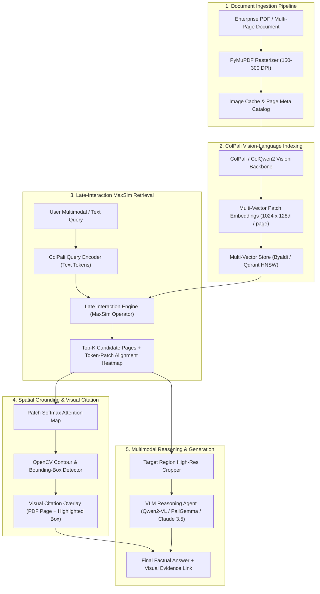

# System Architecture & Technical Specification
## DocuVision-ColPali: Multimodal Visual Document RAG

---

### 1. High-Level Architecture Flowchart

---

### 2. Deep Dive: The Mathematics of ColPali Late Interaction

In traditional dense retrieval (e.g., text-embedding-3-large, BGE-M3):
$$S(q, d) = \mathbf{e}_q^\top \mathbf{e}_d$$
A single 768-dimensional or 1536-dimensional vector must compress all structural, visual, tabular, and textual nuances of an entire document page. This "information bottleneck" discards fine-grained cell relationships.

In **ColPali Late Interaction**:
1. An input query $Q$ with $|Q|$ tokens is encoded into a set of vectors:
   $$E_Q = \{ \mathbf{q}_1, \mathbf{q}_2, \dots, \mathbf{q}_{|Q|} \} \in \mathbb{R}^{|Q| \times D}$$
2. An input document page image $I$ is divided into patches (e.g., $32 \times 32$ grid) and passed through a Vision Transformer (ViT) followed by a projection layer:
   $$E_D = \{ \mathbf{d}_1, \mathbf{d}_2, \dots, \mathbf{d}_{N} \} \in \mathbb{R}^{N \times D} \quad \text{where } N \approx 1024$$
3. The relevance score is computed via the **MaxSim** operator:
   $$\text{Score}(Q, D) = \sum_{i=1}^{|Q|} \max_{j=1}^{N} \left( \frac{\mathbf{q}_i \cdot \mathbf{d}_j^\top}{\|\mathbf{q}_i\| \|\mathbf{d}_j\|} \right)$$
Each query token independently searches for its most relevant image patch. If the query asks for "Net Income 2024", the token "2024" aligns with the column header patch, and "Net Income" aligns with the row label patch.

---

### 3. Spatial Bounding-Box Derivation Algorithm

To generate explainable visual citations:
1. For top retrieved page $D^*$, extract the maximum similarity vector across query tokens:
   $$A_j = \max_{i=1}^{|Q|} (\mathbf{q}_i \cdot \mathbf{d}_j^\top) \quad \forall j \in [1, N]$$
2. Reshape vector $A$ into the 2D patch topology $(H_{\text{patch}}, W_{\text{patch}})$, typically $32 \times 32$.
3. Apply 2D Gaussian blur filter followed by Otsu thresholding:
   $$M_{\text{mask}} = \text{OtsuThreshold}(\mathcal{G}_\sigma(A))$$
4. Detect outer bounding contours using OpenCV:
   $$\mathcal{C} = \text{findContours}(M_{\text{mask}})$$
5. Map normalized patch coordinates back to physical PDF pixel coordinates:
   $$\begin{pmatrix} X \\ Y \end{pmatrix}_{\text{PDF}} = \begin{pmatrix} \frac{x_{\text{patch}}}{W_{\text{patch}}} \times W_{\text{PDF}} \\ \frac{y_{\text{patch}}}{H_{\text{patch}}} \times H_{\text{PDF}} \end{pmatrix}$$

---

### 4. Technical Stack & Component Manifest

| Component | Technology | Rationale |
| :--- | :--- | :--- |
| **PDF Ingestion & Rasterization** | PyMuPDF (fitz) + pdf2image + Pillow | Ultra-fast C-native rendering without external poppler binary dependencies. |
| **Vision-Language Retriever** | ColPali / ColQwen2 via Byaldi / Hugging Face | State-of-the-art Late Interaction VLM retrieval engine. |
| **Multi-Vector Index** | Byaldi (Faiss-based HNSW) / Qdrant Multi-Vector | Accelerated GPU/CPU MaxSim retrieval with memory-mapped storage. |
| **VLM Synthesis Engine** | Qwen2-VL-7B-Instruct / PaliGemma 3B / Anthropic Vision | Native multimodal chain-of-thought table and chart reasoning. |
| **Backend API** | FastAPI + Uvicorn + Pydantic v2 | High-throughput asynchronous serving with strict schema contracts. |
| **Frontend UI** | Streamlit + PDF.js Canvas Overlay | Interactive web workspace displaying PDF pages with dynamic bounding-box highlights. |
| **Evaluation Framework** | ViDoRe (Visual Document Retrieval Benchmark) + Ragas-Vision | Industry-standard benchmark for visual document retrieval evaluation. |
