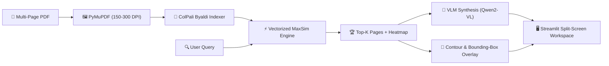

# 📄 DocuVision-ColPali: Enterprise Multimodal Visual Document Intelligence
> **No More OCR Failures.** Visual Document RAG with ColPali Multi-Vector Late Interaction, Spatial Bounding-Box Grounding, and VLM Synthesis.

[](https://www.python.org/downloads/)
[](https://huggingface.co/vidore/colpali)
[](https://fastapi.tiangolo.com)
[](https://streamlit.io)

---

## 🎯 Executive Overview
Standard enterprise RAG pipelines fail when faced with real-world business documents containing complex tables, balance sheets, flowcharts, and corporate infographics. By forcing multi-column documents through traditional OCR text linearization, the spatial arrangement of data is irreversibly corrupted.

**DocuVision-ColPali** changes the paradigm:
1. **Zero Text Extraction / Zero OCR:** Pages are rasterized directly into high-fidelity image representations.
2. **Vision-Language Late Interaction:** Queries match directly with 2D vision patch embeddings ($1024$ tokens/page) via the MaxSim operator.
3. **Visual Grounding with Bounding Boxes:** Query attention heatmaps translate directly into pixel-level bounding boxes highlighting the exact table or chart on the PDF page.
4. **VLM Fact Synthesis:** Multi-modal models (Qwen2-VL / PaliGemma / Claude 3.5) generate grounded answers referencing page numbers and highlighted regions.

> **Encoder note:** `ColPaliEmbedder` defaults to a lightweight `surrogate` encoder for CPU demos. The real ColPali model loads through `byaldi` when you pass its model name, and the code falls back to the surrogate if it cannot load. Demo outputs therefore do not represent ColPali retrieval quality unless the real model is used.

---

## 🏗️ Architecture & Pipeline Flow



---

## 🚀 Quickstart & Setup

```bash
# 1. Clone & Enter Directory
cd Multimodal_VLM_Doc_Intelligence

# 2. Setup Virtual Environment with uv
uv venv
source .venv/bin/activate  # On Windows: .venv\Scripts\activate

# 3. Install Dependencies
uv pip install -e ".[dev]"

# 4. Run Test Suite (11/11 Passing)
pytest tests/ -v

# 5. Start the FastAPI Service
uvicorn src.api.main:app --reload --port 8000

# 6. Launch the Streamlit Interactive Workspace
streamlit run src/ui/app.py
```

---

## 🧪 Live Verification & Demonstration Scripts

The repository includes end-to-end verification scripts covering standard enterprise documents, real-world academic papers, and zero-text scanned bitmaps:

- **End-to-End Enterprise Financial Demo**:
  ```bash
  python scripts/test_e2e_pipeline.py
  ```
  *Rasterizes a 3-page financial report, indexes multi-vector patches, extracts Net Income ($385M) and Cash ($450M), and verifies Refusal Logic on hallucinated queries.*

- **Real-World 12-Page Academic Paper (Springer 2026)**:
  ```bash
  python scripts/test_academic_paper.py
  ```
  *Tests dense 2-column layout, CNN/Attention architecture diagrams, and experimental ablation tables (RTNet: 58.0 mIoU @ 40.2 FPS).*

- **Pure Scanned / Image-Only PDF (Zero Text Layer)**:
  ```bash
  python scripts/test_scanned_pdf.py
  ```
  *Demonstrates native VLM visual transcription and grounding on a 100% bitmap Air Waybill without external Tesseract binaries.*

---

## 🗺️ Codebase Knowledge Graph (Graphify)
The architecture and module interactions are mapped as a queryable knowledge graph:
- **Interactive Visual Graph:** [`graphify-out/graph.html`](graphify-out/graph.html)
- **Architecture Report:** [`graphify-out/GRAPH_REPORT.md`](graphify-out/GRAPH_REPORT.md) (164 nodes, 309 edges, 16 communities)

---

## 📚 Technical Documentation & Blueprints
- [PRD.md](PRD.md): Product Requirements, user personas, and target SLAs.
- [ARCHITECTURE.md](ARCHITECTURE.md): Mathematical formulations of Late Interaction, MaxSim, and Bounding-Box derivation.
- [IMPLEMENTATION_PLAN.md](IMPLEMENTATION_PLAN.md): 6-phase milestone implementation roadmap.
- [VLM_LATE_INTERACTION_THEORY.md](VLM_LATE_INTERACTION_THEORY.md): Deep-dive into Late Interaction vs Dense Bi-Encoders.
- [BENCHMARK_AND_EVALUATION.md](BENCHMARK_AND_EVALUATION.md): ViDoRe benchmark comparison and Ragas-Vision metrics.
- [reports/VIDORE_BENCHMARK_REPORT.md](reports/VIDORE_BENCHMARK_REPORT.md): Illustrative projection of a ViDoRe comparison, not a measured result.
- [DECISIONS.md](DECISIONS.md): Architectural Decision Records (ADRs).
- [TASKS.md](TASKS.md): Live task backlog and implementation tracker (10/10 Completed).
