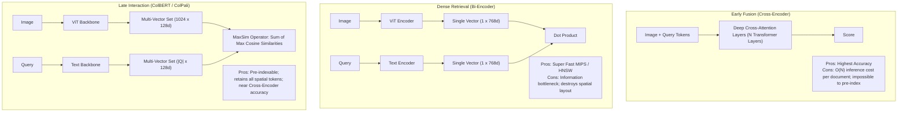

# Theoretical Foundations: Late Interaction in Multimodal Retrieval
## ColPali & Visual Document RAG Deep Dive

---

### 1. The Architectural Paradigm Shift

---

### 2. Mathematical Rigor: The MaxSim Operator
Given query token embeddings $Q = \{ \mathbf{q}_1, \dots, \mathbf{q}_m \}$ and document patch token embeddings $D = \{ \mathbf{d}_1, \dots, \mathbf{d}_n \}$, the similarity score is:

$$S(Q, D) = \sum_{i=1}^{m} \max_{1 \le j \le n} \left( \frac{\mathbf{q}_i \cdot \mathbf{d}_j^\top}{\|\mathbf{q}_i\|_2 \|\mathbf{d}_j\|_2} \right)$$

#### Properties of MaxSim:
1. **Token Alignment Preservation:** Unlike average pooling, where weak signals drown in background noise, an essential query token (such as a specific 4-digit year or currency symbol) will achieve a high score if even a single patch strongly matches it.
2. **Computational Complexity:**
   - Pre-computation: Offline encoding of $D$ is $O(1)$ per query.
   - Online scoring: For a candidate pool of $K$ documents, scoring requires $O(K \times m \times n \times d)$ FLOPs. With $d=128$, $m \le 32$, and $n=1024$, this operation translates into a series of GEMM matrix multiplications executed in microseconds on GPU/AVX-512.

---

### 3. Late Interaction vs. Traditional OCR Pipeline Comparison

| Criteria | Traditional OCR + Text RAG | ColPali Multimodal Late Interaction |
| :--- | :--- | :--- |
| **Pipeline Stages** | PDF $\to$ OCR Engine $\to$ Text Cleaning $\to$ Chunking $\to$ Text Embeddings $\to$ Vector DB $\to$ LLM | PDF $\to$ Page Rasterization $\to$ Vision-Language Embeddings $\to$ Vector DB $\to$ VLM |
| **Points of Information Loss** | 3 (OCR errors, chunk boundary splitting, single-vector pooling) | **0** (Page visual fidelity is completely retained) |
| **Layout & Table Preservation** | Poor (tables linearized into messy Markdown/CSV) | **Native** (Spatial layout is preserved in 2D ViT coordinates) |
| **Chart & Diagram Support** | Nil (requires separate chart captioning pipeline) | **Native** (Visual cues directly match query semantics) |
| **Explainability** | Text quote snippets only | **Visual bounding box overlaid on original page** |
